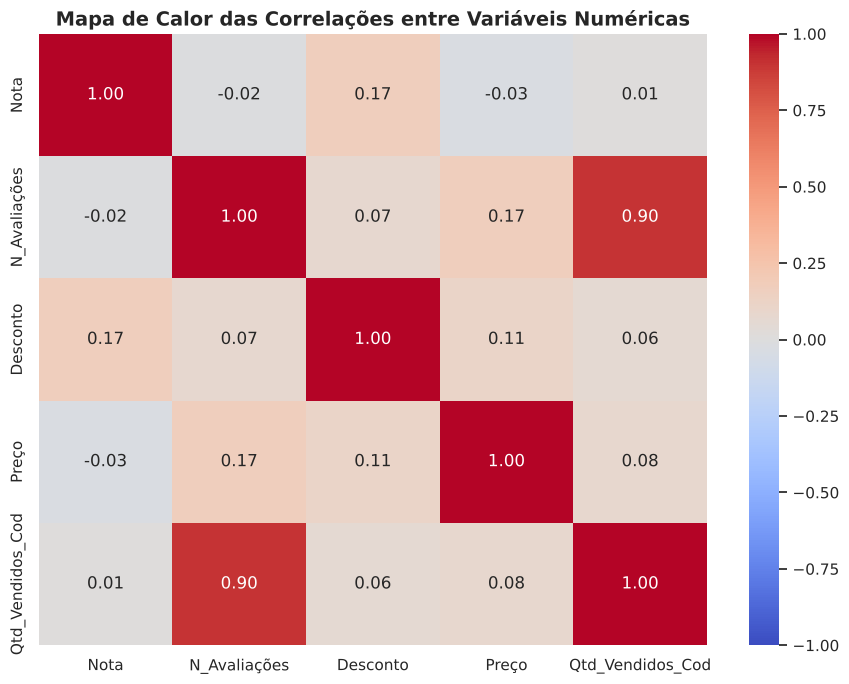
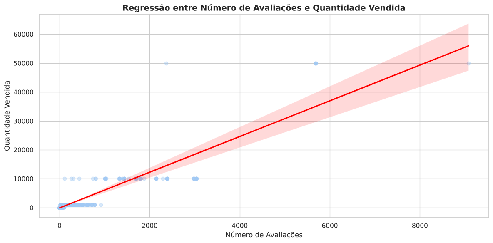

# Visualização de dados de e-commerce

Projeto do curso **Profissão: Cientista de Dados (EBAC)**, Módulo 10 – Visualização de Dados.

Análise exploratória de **2.199 produtos de moda** de um e-commerce, usando sete tipos de gráfico para entender preços, vendas, avaliações e composição do catálogo.

**Autor:** Lucas Farias Epitácio de Almeida

## Gráficos produzidos

| Tipo | Pergunta respondida |
| --- | --- |
| Histograma | Em que faixa de preço está a maior parte dos produtos? |
| Dispersão | Produtos mais baratos vendem mais? |
| Mapa de calor | Quais variáveis numéricas andam juntas? |
| Barras | Como o catálogo se divide por gênero? |
| Pizza | Quais materiais predominam? |
| Densidade | Como as notas dos clientes se distribuem? |
| Regressão | Qual é o tamanho da relação entre avaliações e vendas? |

## Principais achados

- **Preço não explica o volume de vendas** (correlação de 0,08). Produtos de todas as faixas vendem pouco ou muito.
- **O número de avaliações é o melhor indicador de vendas** (correlação de 0,90), o que faz sentido, já que só avalia quem comprou.
- **Metade dos produtos custa entre R$ 50 e R$ 139**, com mediana de R$ 79 e uma cauda de itens caros que chega a R$ 597.
- **O catálogo é majoritariamente feminino e masculino** (723 e 545 produtos), seguido pela linha de bebês (311).
- **Algodão e poliéster dominam os materiais.** "jeans" e "jean" aparecem separados por grafia diferente na base; somados, seriam o terceiro material mais comum.
- **As notas são altas e pouco variáveis** (média de 4,56, metade entre 4,4 e 4,8), o que limita o uso da nota para diferenciar produtos.





## Limitações

- `Qtd_Vendidos_Cod` é uma faixa codificada de vendas (1.000, 10.000, 50.000), não a contagem exata. A correlação de 0,90 é influenciada por poucos produtos nas faixas mais altas, como mostra a regressão.
- `Desconto` está ausente em 60% dos produtos, que são os vendidos sem desconto. As correlações com essa variável consideram só os produtos com desconto.

## Estrutura

```
├── Visualizacao_Dados_M10.ipynb   # notebook executado, com código comentado e análises
├── dados/
│   └── ecommerce_preparados.csv   # base de dados
├── imagens/                       # os 7 gráficos exportados do notebook
└── requirements.txt
```

## Como executar

```bash
pip install -r requirements.txt
jupyter notebook Visualizacao_Dados_M10.ipynb
```

**No Google Colab:** o notebook procura a base em `MyDrive/DADOS/ecommerce_preparados.csv` no seu Google Drive.

## Tecnologias

Python · pandas · Matplotlib · Seaborn
